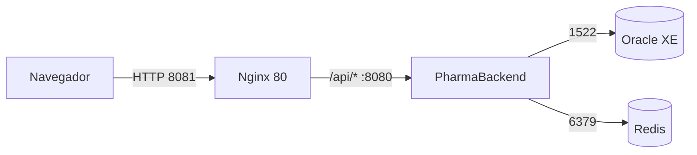

# PharmaFrontend

This project was generated using [Angular CLI](https://github.com/angular/angular-cli) version 22.2.1.

## Development server

To start a local development server, run:

```bash
ng serve
```

Once the server is running, open your browser and navigate to `http://localhost:4200/`. The application will automatically reload whenever you modify any of the source files.

## Code scaffolding

Angular CLI includes powerful code scaffolding tools. To generate a new component, run:

```bash
ng generate component component-name
```

For a complete list of available schematics (such as `components`, `directives`, or `pipes`), run:

```bash
ng generate --help
```

## Building

To build the project run:

```bash
ng build
```

This will compile your project and store the build artifacts in the `dist/` directory. By default, the production build optimizes your application for performance and speed.

## Running unit tests

To execute unit tests with the [Vitest](https://vitest.dev/) test runner, use the following command:

```bash
ng test
```

## Running end-to-end tests

For end-to-end (e2e) testing, run:

```bash
ng e2e
```

Angular CLI does not come with an end-to-end testing framework by default. You can choose one that suits your needs.

## Despliegue en producción

### Arquitectura y puertos



El navegador solo accede a Nginx en el puerto 8081. Nginx sirve los archivos de Angular y reenvía `/api/` al backend en el puerto 8080. Oracle y Redis no deben exponerse al navegador ni a Internet.

### Variables de entorno

Configura en el entorno del backend `SPRING_PROFILES_ACTIVE=prod`, `SERVER_PORT` (puerto HTTP, por defecto 8080), `DB_URL`, `DB_USERNAME`, `DB_PASSWORD`, `JWT_SECRET` (clave Base64 aleatoria de al menos 256 bits), `JWT_EXPIRACION_MINUTOS`, `REDIS_HOST`, `REDIS_PORT`, `REDIS_PASSWORD` y `APP_CACHE_TTL` (por defecto 10m). No guardes valores reales en Git. Nginx usa el nombre de servicio `backend` y el puerto 8080 del host configurado en `deploy/nginx.conf`.

### Construcción y despliegue

1. En el repositorio del backend, configura las variables anteriores y ejecuta `./mvnw -DskipTests package` (en Windows, `mvnw.cmd -DskipTests package`). Despliega el JAR generado con el perfil `prod`.
2. En este repositorio, ejecuta `npm ci` y `npm run build`. La salida queda en `dist/pharma-frontend/browser`.
3. Desde `deploy/`, inicia Redis y Nginx con `docker compose up -d`. Nginx publica la SPA en `http://localhost:8081` y reenvía `/api/` al backend.
4. Comprueba `/actuator/health` y realiza una operación de lectura y otra de escritura desde la SPA antes de habilitar el servicio en los locales.

### Pruebas E2E

La suite requiere que la API y una base de datos de pruebas estén activas. Define las cuentas de prueba en el entorno de la terminal; no se guardan contraseñas en el repositorio. En PowerShell:

```powershell
$env:PHARMA_ADMIN_USER = "<usuario administrador de pruebas>"
$env:PHARMA_ADMIN_PASSWORD = "<contraseña de pruebas>"
$env:PHARMA_VENDEDOR_USER = "<usuario vendedor de pruebas>"
$env:PHARMA_VENDEDOR_PASSWORD = "<contraseña de pruebas>"
$env:PHARMA_ALMACEN_USER = "<usuario almacenero de pruebas>"
$env:PHARMA_ALMACEN_PASSWORD = "<contraseña de pruebas>"
npx playwright test --repeat-each=3 --reporter=list,html
```

Playwright inicia la SPA en `http://localhost:4201`; la API debe estar disponible en `http://localhost:8080`. El informe HTML se genera en `playwright-report/`.

### Reversión

Conserva el directorio `dist/pharma-frontend/browser` de la versión activa antes de reemplazarlo. Si la nueva versión falla, restaura ese directorio y ejecuta `docker compose restart web`. Si también cambió el backend, vuelve al JAR anterior compatible y reinícialo. No reviertas migraciones de base de datos automáticamente; evalúa primero la compatibilidad del esquema y restaura Oracle desde una copia verificada cuando corresponda.

### Buenas prácticas y acciones pendientes

| Práctica | Estado | Acción pendiente |
|---|---|---|
| Archivos Angular con hash e inmutables | Cumple | Confirmar encabezados en Nginx tras cada build. |
| `index.html` se revalida | Cumple | Verificar `Cache-Control: no-cache` en producción. |
| Respuestas del API fuera de caché compartida | Parcial | Validar `no-store` en respuestas del backend y del proxy. |
| Tráfico cifrado con HTTPS | No cumple en la configuración local | Terminar TLS en un proxy con certificado válido antes de usarlo en locales. |
| Secretos fuera del repositorio | Parcial | Inyectar variables mediante un gestor seguro de secretos. |
| Reversión documentada | Cumple | Mantener artefactos versionados y ensayar la reversión. |

### Recomendaciones priorizadas para los tres locales

1. Habilita HTTPS y publica solo Nginx; mantén el backend, Oracle y Redis fuera del acceso directo desde Internet.
2. Programa respaldos cifrados de Oracle y verifica periódicamente que se puedan restaurar.
3. Centraliza la operación de Redis y configura alertas para `/actuator/health`, errores HTTP y falta de espacio.

## Additional Resources

For more information on using the Angular CLI, including detailed command references, visit the [Angular CLI Overview and Command Reference](https://angular.dev/tools/cli) page.
